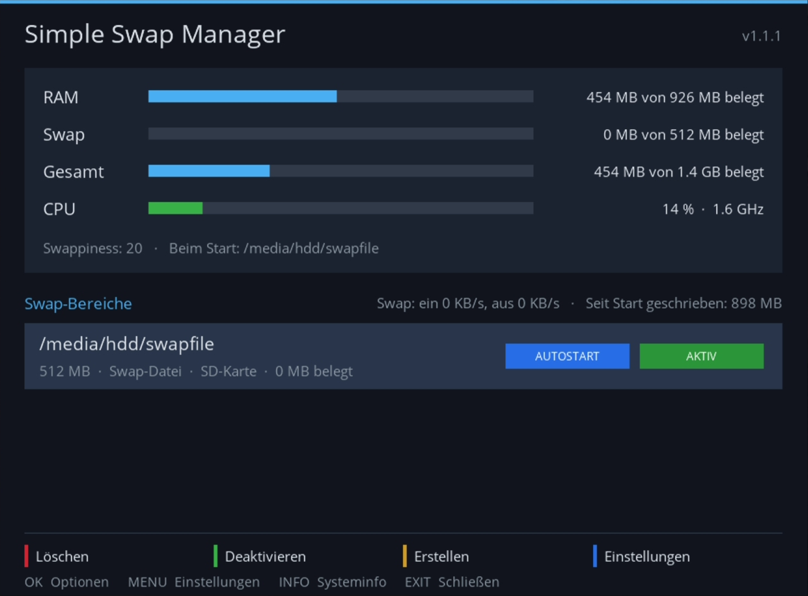
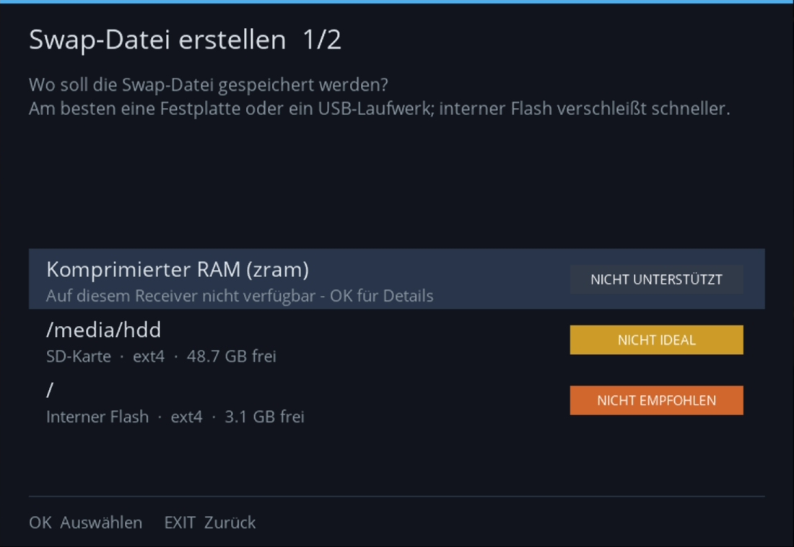

# Simple Swap Manager für Enigma2

*[English version](README.md)*

Ein moderner, einfach zu bedienender Swap-Manager für Enigma2-Receiver
(openATV, OpenPLi, OpenViX, OpenBH, ... – Python 3 und Python 2).

<p>
  
  
</p>

## Funktionen

- Übersicht mit RAM, Swap und Gesamtspeicher live (RAM + Swap = Speicher, den Programme
  tatsächlich nutzen können), alle 3 Sekunden aktualisiert
- CPU-Auslastung als Balken (grün, ab 70 % gelb, ab 90 % rot) mit Taktfrequenz und Temperatur
  (falls der Receiver einen Sensor hat), dazu die Swap-Aktivität: wie viel pro Sekunde ein- und
  ausgelagert wird und wie viel seit dem Start in den Swap geschrieben wurde (der Wert, auf den es
  beim Verschleiß einer SD-Karte ankommt)
- Listet alle Swap-Bereiche auf: aktive und Swap-Dateien auf eingehängten Datenträgern
- Assistent in zwei Schritten zum Anlegen einer Swap-Datei: Datenträger wählen, Größe wählen
  (Vorgaben oder eigene Größe in MB)
- Echter Fortschrittsbalken beim Schreiben der Datei; jederzeit abbrechbar
- Aktivieren / Deaktivieren / Löschen mit einer Taste, Aktivierung beim Start
- Größe einer Swap-Datei ändern (OK-Menü): in einem Ablauf neu angelegt, Autostart und Aktiv-Status bleiben
- Swappiness einstellbar
- **zram** (komprimierter Swap im RAM) als Option – nur sichtbar, wenn der Kernel es unterstützt:
  - kein Datenträger nötig, schnellste Variante; Daten werden im RAM etwa 2-3:1 komprimiert
  - Größenvorgaben (empfohlen: etwa die Hälfte des RAM), Algorithmus automatisch (bevorzugt lz4)
    oder wählbar
  - Priorität 100, wird also vor Swap-Dateien auf Datenträgern genutzt; beides lässt sich kombinieren
  - wird bei jedem Start neu eingerichtet (kein Warten auf einen Datenträger)
  - Live-Statistik: gespeicherte Daten, komprimierte Größe, belegter RAM, Kompressionsrate
  - auf Receivern ohne zram zeigt der Assistent *NICHT UNTERSTÜTZT* und erklärt den Grund
- Systeminformationen: Receiver, Image, Kernel, RAM, Unterstützung für Swap / zram / zswap,
  geeignete Datenträger (INFO-Taste, OK-Menü oder Einstellungen)
- **Speichermangel**: zeigt, wie oft RAM und Swap voll waren und der Kernel ein Programm beenden
  musste (OOM-Killer) – so sieht man, ob überhaupt ein Swap nötig ist oder ob er die Box schon
  gerettet hat. Der Kernel-Log vergisst alte Einträge, deshalb führt das Plugin einen kleinen
  Verlauf (`/etc/enigma2/simpleswapmanager.oom`); die Übersicht meldet Fälle seit dem letzten Start
- Auf Sicherheit ausgelegt:
  - alle länger laufenden Vorgänge sind asynchron, die GUI blockiert nie
  - `dd` läuft mit `nice` und `O_DIRECT`, damit der Page-Cache nicht vollläuft
  - kein `swapoff`, wenn nicht genug freier RAM da ist, um die ausgelagerten Daten zurückzuholen
  - bietet nur Linux-Dateisysteme an (ext2/3/4, xfs, jfs, f2fs); warnt vor dem internen Flash
    und vor SD-Karten (beide verschleißen durch ständiges Schreiben). Die Art wird am Gerät selbst
    erkannt – interner Flash also auch dann, wenn er als `/media/hdd` eingehängt ist, und eine Karte
    in einem (eingebauten) USB-Kartenleser – etwa dem microSD-Slot der SF8008 – als SD-Karte. Nach
    dem Anlegen einer Swap-Datei auf einer SD-Karte bietet das Plugin an, die Swappiness auf 10 zu
    senken (weniger Schreibzugriffe)
  - ist kein externer Datenträger eingehängt, zeigt die Übersicht das sofort an
  - lässt 256 MB auf dem Ziel-Datenträger frei
  - ändert niemals `/etc/fstab`; die Aktivierung beim Start übernimmt das Plugin und wartet bis zu
    3 Minuten, bis der Datenträger eingehängt ist
- Skin-unabhängig: für 1920x1080 gestaltet, automatisch skaliert für HD/FHD/UHD
- Deinstallation aus den Einstellungen (MENU > *Plugin deinstallieren...*): fragt, ob der
  Swap-Speicher behalten (bleibt bis zum nächsten Neustart aktiv) oder sofort gelöscht wird
  (mit derselben Prüfung auf freien RAM), und bietet danach einen GUI-Neustart an
- Update-Hinweis (nur mit Zustimmung, wird einmal gefragt): Beim Öffnen fragt das Plugin
  höchstens einmal am Tag bei GitHub nach der neuesten Version und zeigt oben
  *Update verfügbar* an (Details unten)

## Wohin mit dem Swap?

Vom besten zum ungünstigsten Ort:

| Ort | Verschleiß | Abzeichen im Assistenten |
|---|---|---|
| zram (komprimierter RAM) | keiner – braucht Kernel-Unterstützung | AM SCHNELLSTEN |
| Externe Festplatte (HDD) | praktisch keiner | EMPFOHLEN |
| Externe SSD / USB-Laufwerk | gering (SSDs verteilen die Schreibzugriffe) | EMPFOHLEN |
| SD-Karte (auch im eingebauten Kartenleser) | ja – aber die Karte ist austauschbar; „High Endurance“-Karten halten deutlich länger | NICHT IDEAL |
| Interner Flash (eMMC) | ja – und er ist fest verlötet: verschleißt er, ist der Receiver selbst betroffen | NICHT EMPFOHLEN |

Mit niedriger Swappiness (10-20) lagert ein Receiver im Alltag kaum aus. Die Übersicht zeigt, wie viel seit
dem Start in den Swap geschrieben wurde – so sieht man, ob Verschleiß überhaupt ein Thema ist.

## Tasten

| Taste  | Funktion                              |
|--------|---------------------------------------|
| OK     | Optionen für den gewählten Eintrag    |
| ROT    | Swap-Datei löschen / zram entfernen   |
| GRÜN   | Aktivieren / Deaktivieren             |
| GELB   | Neue Swap-Datei anlegen               |
| BLAU / MENU | Einstellungen                    |
| INFO   | Systeminformationen                   |

Das Plugin findest du im Plugin-Browser und unter *Einstellungen → System → Datenträger*
(openATV) bzw. im Systemmenü (andere Images). Es heißt **Simple Swap Manager**, damit es nicht
mit dem eingebauten „Swap Manager“ von openATV und dem alten Plugin `swapmanager` verwechselt wird.

## Bauen

Voraussetzungen: `msgfmt` (gettext), `ar`, `tar`.

```sh
./build.sh
# -> dist/enigma2-plugin-systemplugins-simpleswapmanager_<version>_all.ipk  (opkg-Images)
# -> dist/enigma2-plugin-systemplugins-simpleswapmanager_<version>_all_experimental.deb  (DreamOS, experimentell)
# -> dist/SHA256SUMS  (Prüfsummen für die Release-Seite)
```

Die `.deb` ist für DreamOS (Dreambox DM900/DM920/One/Two). Sie wird aus denselben Dateien gebaut
und wurde mit `dpkg` unter Debian getestet, aber **noch nicht auf einer echten Dreambox** –
Rückmeldungen sind willkommen. Der Code läuft unter Python 3 und Python 2.7 (mit Python 2.7 geprüft).

Tests (ohne Receiver, Python 3 oder 2.7):

```sh
python3 -m unittest discover -s tests
```

Installation auf dem Receiver:

```sh
scp dist/*.ipk root@<box>:/tmp/
ssh root@<box> 'opkg install /tmp/enigma2-plugin-systemplugins-simpleswapmanager_*_all.ipk'
# DreamOS: dpkg -i /tmp/...deb; apt-get -f install
# danach die GUI neu starten
```

Download prüfen (optional): Zu jedem Release gibt es eine Datei `SHA256SUMS`. Lege sie neben
das Paket und führe `sha256sum -c --ignore-missing SHA256SUMS` aus – es muss `OK` erscheinen.
GitHub zeigt die SHA-256 jeder Datei außerdem auf der Release-Seite an.

Updates: das neue Paket genauso installieren, die Einstellungen bleiben erhalten. Das Plugin ist
nicht im Feed des Images, das normale Software-Update sieht es also nicht. Beim ersten Öffnen
fragt das Plugin deshalb, ob es nach Updates suchen darf. Nur nach einem *Ja* fragt es beim
Öffnen höchstens einmal am Tag bei GitHub nach der neuesten Version (eine HTTPS-Anfrage an
`api.github.com`, übertragen werden nur die IP-Adresse und der User-Agent
`SimpleSwapManager/<Version>`) und zeigt oben *Update verfügbar* an. Heruntergeladen oder
installiert wird nichts automatisch. Die Entscheidung lässt sich jederzeit in den Einstellungen
ändern (*Nach Updates suchen*).

Deinstallation: in den Plugin-Einstellungen (*Plugin deinstallieren...*) oder mit `opkg remove
enigma2-plugin-systemplugins-simpleswapmanager` (DreamOS: `dpkg -r ...`). Beim Entfernen im
Terminal bleibt der Swap-Speicher immer unangetastet: Eine aktive Swap-Datei bleibt bis zum
nächsten Neustart aktiv und auf dem Datenträger liegen; das Terminal zeigt, wie man sie löscht.

## Übersetzungen

Ausgangssprache ist Englisch. Enthalten: العربية, Български, Čeština, Dansk, Deutsch, Eesti, Ελληνικά,
Español, Français, עברית, Hrvatski, Italiano, Latviešu, Lietuvių, Magyar, Nederlands, Norsk (bokmål),
Polski, Português, Română, Русский, Slovenčina, Slovenščina, Srpski (latinica), Suomi, Svenska, ไทย,
Tiếng Việt, Türkçe, Українська, 简体中文. Außer Deutsch sind das KI-Übersetzungen – Korrekturen von
Muttersprachlern sind sehr willkommen (einfach `po/<lang>.po` bearbeiten). Die Übersetzungen
liegen in `po/<lang>.po` und werden von `build.sh` automatisch nach
`locale/<lang>/LC_MESSAGES/SimpleSwapManager.mo` übersetzt. Arabisch und Hebräisch stellt das
Image von rechts nach links dar; Texte mit Zeilenumbruch können dort durcheinandergeraten –
eine Einschränkung der Textdarstellung von Enigma2.

Vorlage nach Textänderungen aktualisieren:

```sh
xgettext --from-code=UTF-8 -L Python -k_ --no-location \
  -o po/SimpleSwapManager.pot src/SimpleSwapManager/*.py
for po in po/*.po; do msgmerge -U "$po" po/SimpleSwapManager.pot; done
```

Die Texte der Paket-Skripte (Installation / Update / Entfernen im Terminal oder in der
GUI-Konsole): Englisch in `CONTROL/common.sh` (`msg_en`), Übersetzungen in
`CONTROL/i18n/<lang>.sh` (`msg_<lang>`, gleiche Schlüssel). Die dort angezeigten Menüpfade
verwenden die Menünamen von openATV. Die Skripte richten sich nach der GUI-Sprache (das Plugin
speichert sie in `/etc/enigma2/simpleswapmanager.lang`, sonst werden `config.misc.locale` /
`config.osd.language` aus den Einstellungen verwendet) und nutzen in einem echten Terminal
Farben und Unicode-Symbole, sonst reines ASCII.

Neue Sprache hinzufügen (Beispiel: Isländisch):

```sh
msginit -i po/SimpleSwapManager.pot -o po/is.po -l is
cp CONTROL/i18n/de.sh CONTROL/i18n/is.sh   # msg_de -> msg_is umbenennen
# beide Dateien übersetzen, den Namen in lang_name in CONTROL/common.sh eintragen, dann ./build.sh
```

## Aufbau

```
src/SimpleSwapManager/
  __init__.py    gettext-Einrichtung
  plugin.py      Plugin-Deskriptoren, Konfiguration, Aktivierung beim Start
  ui.py          Bildschirme (Übersicht, Assistent, Fortschritt, Einstellungen, Systeminfo)
  swaputil.py    System-Hilfsfunktionen (ohne enigma2-Importe, überall testbar)
  plugin.png
po/              Übersetzungen
screenshots/     Bilder für die READMEs
CONTROL/         ipk-Steuerdateien und Paket-Skripte (common.sh = gemeinsame Texte und Ausgabe)
build.sh         Paket-Builder
tests/           Tests für swaputil.py
```

## Lizenz

Copyright (C) 2026 Paderman

Dieses Programm ist freie Software: Sie können es unter den Bedingungen der GNU General Public
License, wie von der Free Software Foundation veröffentlicht, weitergeben und/oder verändern,
entweder gemäß **Version 2 der Lizenz oder (nach Ihrer Wahl) jeder späteren Version**
(`GPL-2.0-or-later`). Siehe [LICENSE](LICENSE).
