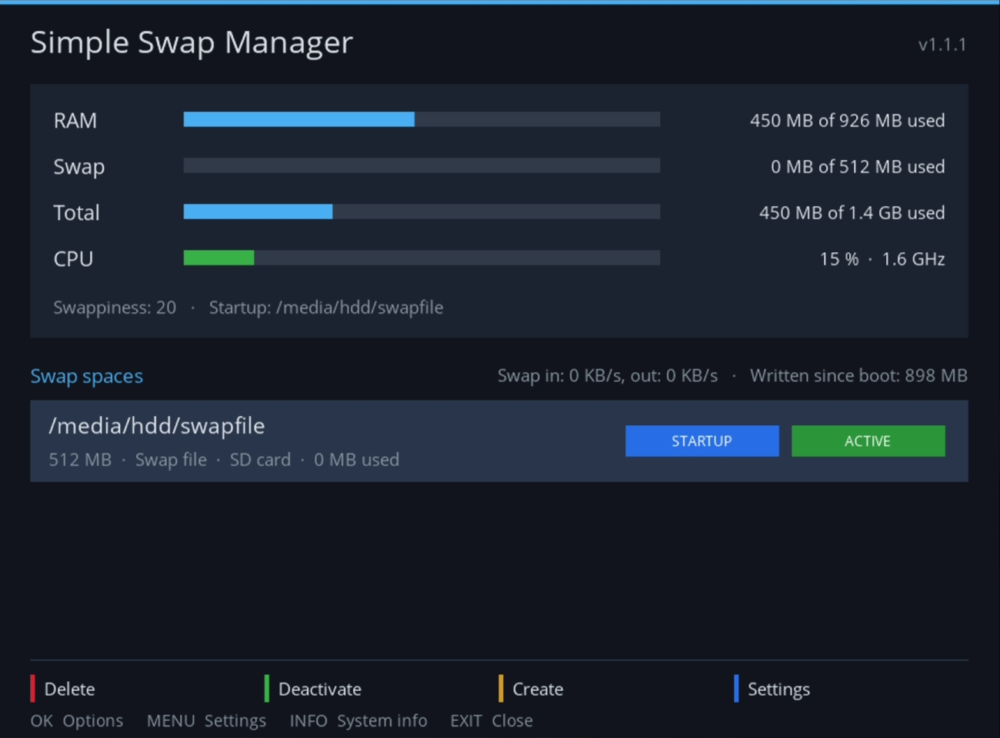
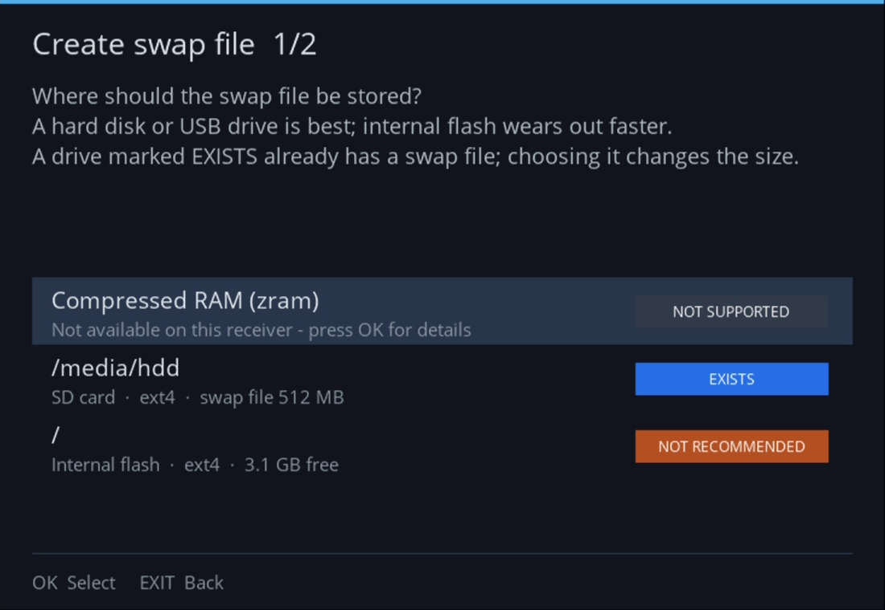

# Simple Swap Manager for Enigma2

*[Deutsche Version](README.de.md)*

A modern, easy to use swap file manager for Enigma2 receivers
(openATV, OpenPLi, OpenViX, OpenBH, ... – Python 3 and Python 2).

<p>
  
  
</p>

## Features

- Dashboard with live RAM, swap and total usage (RAM + swap = memory programs can really use),
  updated every 3 seconds
- CPU load as a bar (green, yellow from 70 %, red from 90 %) with clock speed and temperature
  (if the receiver has a sensor), plus swap activity: how much is swapped in / out per second and
  how much was written to swap since boot (the number that matters for SD card wear)
- Lists all swap spaces: active ones and swap files found on mounted drives
- Two-step wizard to create a swap file: choose drive, choose size (presets or custom size in MB)
- Real progress bar while the file is written; can be cancelled at any time
- Activate / deactivate / delete with one key, activation at startup
- Change the size of a swap file (OK menu): recreated in one go, startup setting and active state are kept
- Swappiness setting
- **zram** (compressed swap in RAM) as an option – only shown when the kernel supports it:
  - no drive needed, fastest option; data is compressed about 2-3:1 inside the RAM
  - size presets (recommended: about half the RAM), algorithm automatic (lz4 preferred) or selectable
  - priority 100, so it is used before swap files on drives; both can be combined
  - set up again at every startup (no drive to wait for)
  - live statistics: stored data, compressed size, RAM in use, compression ratio
  - on receivers without zram the wizard shows it as *NOT SUPPORTED* and explains why
- System information screen: receiver, image, kernel, RAM, swap / zram / zswap support,
  usable drives (INFO key, OK menu or settings)
- **Out of memory**: shows how often RAM and swap were full and the kernel had to end a program
  (OOM killer) – so you can see whether a swap file is needed at all, or whether it already saved
  the receiver. The kernel log forgets old lines, so the plugin keeps a small history
  (`/etc/enigma2/simpleswapmanager.oom`); the dashboard reports kills since the last start
- Safe by design:
  - all long running work is asynchronous, the GUI never blocks
  - `dd` runs with `nice` and `O_DIRECT`, so the page cache is not flooded
  - refuses to `swapoff` when there is not enough free RAM to take back the swapped pages
  - only offers Linux file systems (ext2/3/4, xfs, jfs, f2fs); warns before using the internal flash
    or an SD card (both wear out from constant writes). The type is read from the device itself, so
    internal flash is recognised even when it is mounted as `/media/hdd`, and a memory card in a
    (built-in) USB card reader – like the microSD slot of the SF8008 – as an SD card. After creating
    a swap file on an SD card, the plugin offers to lower the swappiness to 10 (fewer writes)
  - if no external drive is mounted, the dashboard says so right away
  - keeps 256 MB free on the target drive
  - never edits `/etc/fstab`; activation at startup is done by the plugin and waits up to
    3 minutes for the drive to be mounted
- Skin independent: designed for 1920x1080, automatically scaled to HD/FHD/UHD
- Uninstall from the settings (MENU > *Uninstall plugin...*): asks whether the swap space is kept
  (stays active until the next restart) or deleted right away (with the same free-RAM check),
  then offers to restart the GUI
- Update hint (only if you agree, asked once): when the plugin is opened, it asks GitHub at most
  once a day for the latest release and shows *Update available* at the top (details below)

## Where should the swap go?

From best to worst:

| Location | Wear | Badge in the wizard |
|---|---|---|
| zram (compressed RAM) | none – needs kernel support | FASTEST |
| External hard disk (HDD) | practically none | RECOMMENDED |
| External SSD / USB drive | low (SSDs spread the writes) | RECOMMENDED |
| SD card (also in a built-in card reader) | yes – but the card can be replaced; "High Endurance" cards last much longer | NOT IDEAL |
| Internal flash (eMMC) | yes – and it is soldered in: if it wears out, the receiver itself is affected | NOT RECOMMENDED |

With a low swappiness (10-20) a receiver hardly swaps at all in normal use. The dashboard shows how much
was written to swap since boot, so you can see whether wear is an issue at all.

## Keys

| Key    | Function                         |
|--------|----------------------------------|
| OK     | Options for the selected entry   |
| RED    | Delete swap file / remove zram   |
| GREEN  | Activate / deactivate            |
| YELLOW | Create a new swap file           |
| BLUE / MENU | Settings                    |
| INFO   | System information               |

The plugin is available in the plugin browser and in *Setup → System → Storage Devices*
(openATV) or the system menu (other images). It is called **Simple Swap Manager** to keep it
apart from openATV's built-in "Swap Manager" and the old `swapmanager` plugin.

## Build

Requirements: `msgfmt` (gettext), `ar`, `tar`.

```sh
./build.sh
# -> dist/enigma2-plugin-systemplugins-simpleswapmanager_<version>_all.ipk  (opkg images)
# -> dist/enigma2-plugin-systemplugins-simpleswapmanager_<version>_all_experimental.deb  (DreamOS, experimental)
# -> dist/SHA256SUMS  (checksums for the release page)
```

The `.deb` is for DreamOS (Dreambox DM900/DM920/One/Two). It is built from the same files and was
tested with `dpkg` on Debian, but **not yet on a real Dreambox** - feedback welcome.
The code runs on Python 3 and Python 2.7 (checked with Python 2.7).

Tests (no receiver needed, Python 3 or 2.7):

```sh
python3 -m unittest discover -s tests
```

Install on the receiver:

```sh
scp dist/*.ipk root@<box>:/tmp/
ssh root@<box> 'opkg install /tmp/enigma2-plugin-systemplugins-simpleswapmanager_*_all.ipk'
# DreamOS: dpkg -i /tmp/...deb; apt-get -f install
# restart the GUI afterwards
```

Check the download (optional): every release has a `SHA256SUMS` file. Put it next to the
package and run `sha256sum -c --ignore-missing SHA256SUMS` – it must say `OK`. GitHub also
shows the SHA-256 of each file on the release page.

Updates: install the new package the same way, the settings are kept. The plugin is not in the
image's feed, so the normal software update does not see it. The first time the plugin is opened,
it asks whether it may look for updates. Only after a *yes*, it asks GitHub at most once a day
when the plugin is opened (one HTTPS request to `api.github.com`; only the IP address and the
User-Agent `SimpleSwapManager/<version>` are transmitted) and shows *Update available* at the
top. Nothing is downloaded or installed automatically. The choice can be changed at any time in
the settings (*Check for updates*).

Uninstall: in the plugin settings (*Uninstall plugin...*), or with `opkg remove
enigma2-plugin-systemplugins-simpleswapmanager` (DreamOS: `dpkg -r ...`). Removing the package
in a terminal never touches the swap space: an active swap file stays active until the next
restart and remains on the drive; the terminal shows how to delete it.

## Translations

English is the source language. Included: العربية, Български, Čeština, Dansk, Deutsch, Eesti, Ελληνικά,
Español, Français, עברית, Hrvatski, Italiano, Latviešu, Lietuvių, Magyar, Nederlands, Norsk (bokmål),
Polski, Português, Română, Русский, Slovenčina, Slovenščina, Srpski (latinica), Suomi, Svenska, ไทย,
Tiếng Việt, Türkçe, Українська, 简体中文. Apart from German these are AI translations –
corrections from native speakers are very welcome (just edit `po/<lang>.po`).
Arabic and Hebrew are shown right-to-left by the image; texts with a line break may be
reordered oddly there, a limitation of the Enigma2 text renderer. Translations live in `po/<lang>.po` and are compiled
automatically by `build.sh` into `locale/<lang>/LC_MESSAGES/SimpleSwapManager.mo`.

Update the template after changing strings:

```sh
xgettext --from-code=UTF-8 -L Python -k_ --no-location \
  -o po/SimpleSwapManager.pot src/SimpleSwapManager/*.py
for po in po/*.po; do msgmerge -U "$po" po/SimpleSwapManager.pot; done
```

The texts shown by the package scripts (install / update / removal in a terminal or
the GUI console): English in `CONTROL/common.sh` (`msg_en`), translations in
`CONTROL/i18n/<lang>.sh` (`msg_<lang>`, same keys). The menu paths shown there use openATV's own menu
names. The scripts follow the GUI language (the plugin stores it in `/etc/enigma2/simpleswapmanager.lang`,
otherwise `config.misc.locale` / `config.osd.language` from the settings are used),
use colours and Unicode symbols on a real terminal and plain ASCII otherwise.

Add a new language (example: Icelandic):

```sh
msginit -i po/SimpleSwapManager.pot -o po/is.po -l is
cp CONTROL/i18n/de.sh CONTROL/i18n/is.sh   # rename msg_de -> msg_is
# translate both files, add the name to lang_name in CONTROL/common.sh, then ./build.sh
```

## Layout

```
src/SimpleSwapManager/
  __init__.py    gettext setup
  plugin.py      plugin descriptors, config, startup activation
  ui.py          screens (main, wizard, progress, settings, system info)
  swaputil.py    system helpers (no enigma2 imports, testable anywhere)
  plugin.png
po/              translations
screenshots/     images for the READMEs
CONTROL/         ipk control files and package scripts (common.sh = shared texts and output)
build.sh         package builder
tests/           tests for swaputil.py
```

## License

Copyright (C) 2026 Paderman

This program is free software: you can redistribute it and/or modify it under the terms of the
GNU General Public License as published by the Free Software Foundation, either **version 2 of
the License, or (at your option) any later version** (`GPL-2.0-or-later`). See [LICENSE](LICENSE).
